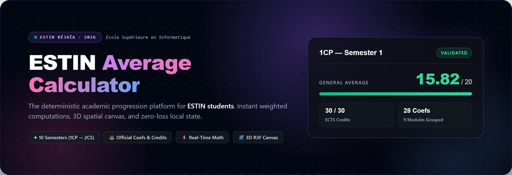
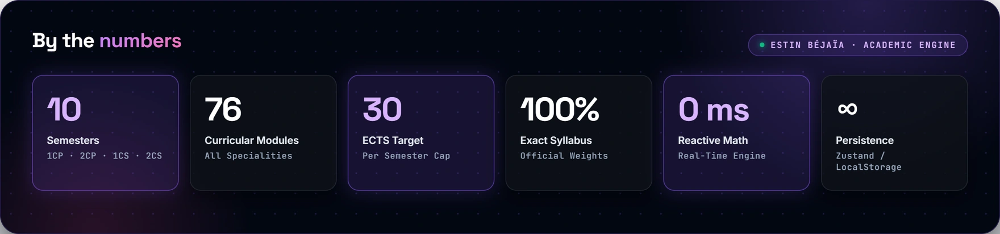
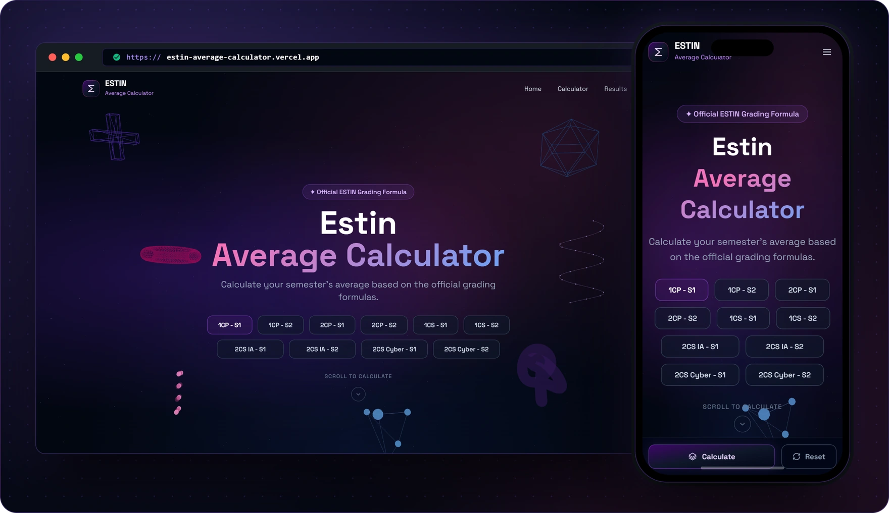
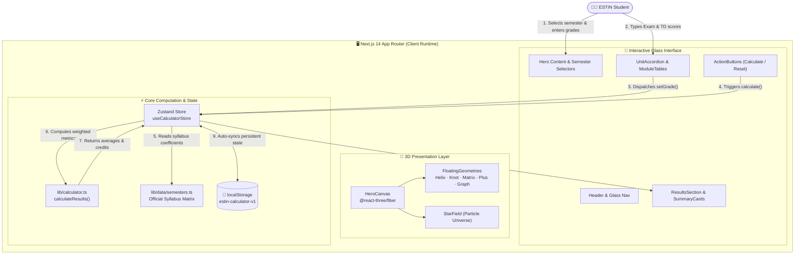

<div align="center">

<a href="https://estin-average-calculator.vercel.app">
  
</a>

<br><br>

# 📐 ESTIN Average Calculator
### *Academic precision at scale · Every semester, every coefficient, real-time clarity.*

[](https://estin-average-calculator.vercel.app)
[](https://estin-average-calculator.vercel.app)
[](https://nextjs.org)
[](https://www.typescriptlang.org)
[](https://tailwindcss.com)
[](https://threejs.org)
[](https://estin.dz)
[](https://github.com/islemredouane)

<br>

**10 Semesters (1CP → 2CS) · Exact Ministerial Syllabi · Reactive Live Calculations · 3D Floating Geometry Hero · Offline Persistence**<br>
The modern student-engineered grade calculation and academic progression platform for **ESTIN Béjaïa** (*École Supérieure en Sciences et Technologies de l'Informatique et du Numérique*).  
Engineered with real-time mathematical validation, interactive 3D spatial graphics, and zero-loss local storage caching.

<br>

[**Launch Calculator**](https://estin-average-calculator.vercel.app) &nbsp;✦&nbsp;
[**Overview**](#-overview) &nbsp;✦&nbsp;
[**Key Features**](#-key-features) &nbsp;✦&nbsp;
[**Academic Architecture**](#-academic-architecture--grading-formula) &nbsp;✦&nbsp;
[**System Architecture**](#-system-architecture) &nbsp;✦&nbsp;
[**Visual Identity**](#-visual-identity--design-tokens) &nbsp;✦&nbsp;
[**Project Structure**](#-project-structure) &nbsp;✦&nbsp;
[**Getting Started**](#-getting-started) &nbsp;✦&nbsp;
[**The Author**](#-the-author--leadership)

</div>

<br>



<br><br>

---

## ✦ Overview

**ESTIN** (*École Supérieure en Sciences et Technologies de l'Informatique et du Numérique*) in Amizour, Béjaïa, operates on an intensive, rigorous higher national curriculum. Students navigate distinct academic stages: the Preparatory Classes (**1CP** and **2CP**) and the Higher Engineering Cycles (**1CS** and **2CS** with specializations in **Artificial Intelligence & Data Science** and **Cybersecurity**).

Each semester is organized into strict pedagogical units:
* **UEF** (*Unités d'Enseignement Fondamentales*) — Core theoretical & programming foundations.
* **UEM** (*Unités d'Enseignement Méthodologiques*) — Practical, operational, and engineering methods.
* **UET** (*Unités d'Enseignement Transversales*) — Technical languages and communication.
* **UED** (*Unités d'Enseignement Découverte*) — Complementary, economic, and entrepreneurial studies.

Calculating semester averages accurately by hand is tedious and error-prone due to varying continuous assessment ratios (Exam $\times 2$ + TD), module coefficients ($1$ to $5$), unit groupings, and credit compensation mechanics.

**ESTIN Average Calculator** eliminates friction by providing a deterministic, reactive, client-side computational environment. Built on **Next.js 14 App Router**, **TypeScript**, and **Tailwind CSS**, it pairs an exact syllabus engine with a space-grade 3D mathematical hero rendered with **React Three Fiber** and **Three.js**, full mobile responsiveness, and client-side persistence via **Zustand**.

<br>

<div align="center">
  
</div>

<br>

---

## ✦ Key Features

<table>
<tr>
<td width="50%" valign="top">

### 🎓 01 · Full Academic Coverage
- **10 Complete Semesters:** Covers 1CP (S1/S2), 2CP (S1/S2), 1CS (S1/S2), and both specialized 2CS tracks (AI & Data Science, Cybersecurity).
- **One-Tap Semester Switcher:** Instant smooth transition between semesters with dedicated animated pill selectors.
<br><sub>Route: <code>/#calculator</code> · Source: <code>lib/data/semesters.ts</code></sub>

### ⚖️ 02 · Exact Ministerial Formula
- **Official Weightings:** Every module carries its exact syllabus coefficient and ECTS credit weight.
- **2:1 Ratio Standard:** Strict compliance with ESTIN's $(2 \times \text{Exam} + \text{TD}) / 3$ continuous assessment formula.
<br><sub>Source: <code>lib/calculator.ts</code></sub>

### ⚡ 03 · Reactive Live Math
- **Real-Time Calculation:** Unit averages, semester totals, and earned credits update immediately on keystroke without lag.
- **Color-Coded Status:** Modules and units dynamically glow green ($\ge 10.00$) or red ($< 10.00$) to highlight academic standing.
<br><sub>Components: <code>AverageCell.tsx</code> · <code>UnitCard.tsx</code></sub>

### 🎯 04 · Credit & Compensation Auditing
- **ECTS Credit Tracking:** Monitors the 30-credit semester ceiling with animated progress bars.
- **Compensation Rules:** Clarifies whether validated units compensate for deficit modules.
<br><sub>Components: <code>SemesterSummaryCard.tsx</code> · <code>ProgressBar.tsx</code></sub>

</td>
<td width="50%" valign="top">

### 🌌 05 · 3D Mathematical Spatial Canvas
- **Parametric Floating Geometries:** Real-time WebGL canvas rendering mathematical artifacts:
  - **Helix Spirals:** Infinite series, recursion, and algorithm flow.
  - **Torus Knots:** Topology, smooth manifold curves, and calculus.
  - **Matrix Grids:** 3D linear algebra dot arrays.
  - **Graph Nodes & Arithmetic:** Floating network edges and wireframe plus operators.
<br><sub>Tech: <code>@react-three/fiber</code> · <code>three.js</code></sub>

### 💾 06 · Zero-Loss Local Persistence
- **State Preservation:** Grades, names, and active semester are cached locally via Zustand's `localStorage` engine.
- **Accidental Close Protection:** Refreshing or navigating away never wipes typed marks.
<br><sub>Store: <code>store/calculatorStore.ts</code></sub>

### 📱 07 · Adaptive Glassmorphic Architecture
- **Accordion Units:** Expandable/collapsible pedagogical units tailored for small mobile screens.
- **Glass HUD:** Modern frosted glass surfaces (`backdrop-blur-xl`), animated gradients, and micro-interactions powered by Framer Motion.
<br><sub>Styles: <code>app/globals.css</code> · <code>GlassCard.tsx</code></sub>

### 🖨️ 08 · Print & Bulletin Mode
- **Transcript Ready:** Dedicated `@media print` rules strip navigation, hero animations, and action buttons, leaving a pristine clean academic report ready for PDF export or paper printing.
<br><sub>Styles: <code>app/globals.css</code></sub>

</td>
</tr>
</table>

<br>

---

## ✦ Academic Architecture & Grading Formula

ESTIN follows the ministerial LMD / Engineering school pedagogical framework. The computation engine executes the exact official evaluation hierarchy:

### 1. Module Average ($M$)
For any module comprising a written final examination ($\text{Exam}$) and directed practical coursework ($\text{TD}$):

$$\text{Module Average} = \frac{2 \times \text{Exam} + \text{TD}}{3}$$

### 2. Teaching Unit Average ($UE$)
A Teaching Unit ($UE_k$) groups $n$ modules with specific coefficients $C_i$:

$$UE_k = \frac{\sum_{i=1}^{n} (M_i \times C_i)}{\sum_{i=1}^{n} C_i}$$

### 3. General Semester Average ($S$)
The overall semester average is the weighted mean across all teaching units:

$$S = \frac{\sum_{k} (UE_k \times C_{UE_k})}{\sum_{k} C_{UE_k}} = \frac{\sum_{j=1}^{N} (M_j \times C_j)}{\sum_{j=1}^{N} C_j}$$

### 4. Credit Validation & Compensation Rules
* **Module Validation:** Any module with an average $M \ge 10.00 / 20.00$ immediately validates its assigned ECTS credits.
* **Unit Compensation:** If a unit's weighted average $UE_k \ge 10.00 / 20.00$, the unit is validated, and **all credits of that unit are awarded**, even for modules below $10.00$.
* **Semester Compensation:** If the overall semester average $S \ge 10.00 / 20.00$, the student validates the semester with the full **30 ECTS credits**.

<br>

### ✦ Supported Curricula Matrix

| Cycle | Semester | Key Modules | Coefs | Total Credits |
|---|---|---|:---:|:---:|
| **1CP** | **S1** | ALSDS (5), ARCH 1 (4), ANA 1 (5), ALG 1 (3), ELECT (3), SYST 1 (3), TEE (2), ANG 1 (2), HIST (1) | 28 | 30 |
| **1CP** | **S2** | ALSDD (5), SYST 2 (3), ANA 2 (5), ALG 2 (3), ELEF 1 (4), MECA (3), TEO (2) | 25 | 30 |
| **2CP** | **S1** | SFSD (4), ARCH 2 (4), ELECT 2 (4), ANA 3 (5), ALG 3 (3), PROBA 1 (4), ANGLAIS (2), ECONOMY (2) | 28 | 30 |
| **2CP** | **S2** | ANAL 4 (5), LOGM (4), POO (4), SINF (3), PRJP (4), PRST 2 (4), OOE (3), ANG 3 (2) | 29 | 30 |
| **1CS** | **S1** | Système d'exploitation (3), Réseaux 1 (2), Bases de données (3), Génie logiciel (2), RO 1 (2), Files d'attente (2), Théorie des langages (2), Anglais 1 (1) | 17 | 30 |
| **1CS** | **S2** | Architectures distribuées (2), Réseaux 2 (2), IA (3), Sécurité informatique (3), RO 2 (2), Méthodes formelles (2), Analyse numérique (2), Entrepreneuriat (1) | 17 | 30 |
| **2CS IA** | **S1** | Fondements Data Science (3), Complexité (2), BDD avancées (3), Ingénierie logiciels (2), Cloud (2), Conduite de Projet (2), Analyse de données (2), Anglais 2 (1) | 17 | 30 |
| **2CS IA** | **S2** | Machine Learning (3), Big Data (2), Ingénierie connaissances (3), BDD distribuées (2), Stats avancées (2), Traitement d'image (2), Séries chronologiques (2), Tech Numérique (1) | 17 | 30 |
| **2CS Cyber** | **S1** | Fondements Data Science (3), Complexité (2), BDD avancées (3), Ingénierie logiciels (2), Cloud (2), Conduite de Projet (2), Analyse de données (2), Anglais 2 (1) | 17 | 30 |
| **2CS Cyber** | **S2** | Méthodes formelles sécurité (3), Machine Learning (3), Admin système & réseaux (2), Cryptographie avancée (2), Sécurité réseaux (2), Sécurité OS (2), Audit sécurité SI (2), Biométrie (2) | 18 | 30 |

<br>

---

## ✦ System Architecture



<br>

### Layer Responsibilities

| Layer | Files | Description |
|---|---|---|
| **Syllabus Data** | `lib/data/semesters.ts`<br>`lib/data/types.ts` | Strictly typed dataset defining every module, unit, coefficient, and credit per semester. |
| **Math Engine** | `lib/calculator.ts` | Pure functional calculation logic computing module averages, unit aggregates, and compensations. |
| **Reactive Store** | `store/calculatorStore.ts` | Zustand store managing grade inputs, selected semester, calculation results, and local persistence. |
| **3D Canvas** | `components/hero/*` | React Three Fiber WebGL scene hosting animated geometric objects that reflect computational math. |
| **Glass UI** | `components/calculator/*`<br>`components/results/*` | Mobile-first glassmorphic cards, accordions, dynamic inputs, and animated progress gauges. |
| **Design System** | `app/globals.css`<br>`tailwind.config.ts` | Design tokens, color system, ambient glows, keyframe animations, and print stylesheets. |

<br>

---

## ✦ Visual Identity & Design Tokens

The application embraces a **deep cosmic dark aesthetic** balanced with glowing neon mathematical accents, high-translucency glass surfaces, and responsive spring physics.

### Color Palette

| Swatch | Token | Hex / Value | Architectural Purpose |
|:---:|---|---|---|
| `⬛` | `--bg-base` | `#030712` | Deep void page background (Gray 950) |
| `🔲` | `--bg-surface` | `#0D1117` · `rgba(13, 17, 23, 0.7)` | Frosted glass panel base with 20px blur |
| `🔳` | `--bg-elevated` | `#161B22` | Raised cards, popovers, and input backgrounds |
| `🟪` | `--color-purple` | `#8B5CF6` | Primary brand accent: buttons, sigma logo, hero glow |
| `🌸` | `--color-pink` | `#EC4899` | Secondary gradient accent & shine highlights |
| `🔷` | `--color-blue` | `#60A5FA` | Tertiary gradient spectrum for headings and 3D wireframes |
| `🟩` | `--color-pass` | `#10B981` | Validation state ($\ge 10.00$), 30-credit pass badge |
| `🟥` | `--color-fail` | `#EF4444` | Deficit alert state ($< 10.00$), catch-up indicators |

<br>

### Signature Design Tokens

```css
/* Signature Multi-Stop Gradient */
background: linear-gradient(135deg, #a78bfa, #f472b6, #60a5fa);

/* Glassmorphism Surface */
background: rgba(13, 17, 23, 0.7);
backdrop-filter: blur(20px);
border: 1px solid rgba(139, 92, 246, 0.2);
```

| Element | Specification |
|---|---|
| **Typography** | Modern sans-serif stack (`Inter`, system-ui), high legibility numbers for grades, wide-tracked uppercase labels (`tracking-wider`). |
| **The Sigma Logo ($\Sigma$)** | Hand-crafted SVG polyline with a dual-stop pastel gradient (`#ddd6fe` → `#fbcfe8`), symbolizing mathematical summation. |
| **Glass Accordion** | Units smoothly slide open with spring transitions (`stiffness: 200`, `damping: 24`). |
| **Micro-Interactions** | Framer Motion hover lifts (`y: -2px`, `scale: 1.02`) on buttons and cards with haptic-like button presses (`scale: 0.98`). |
| **3D Elements** | Parametric wireframe materials with emissive lighting for lightweight 60 FPS WebGL rendering on mobile devices. |

<br>

---

## ✦ Project Structure

```text
ESTIN-Average-Calculator/
├── app/
│   ├── favicon.ico                   # Standard favicon
│   ├── globals.css                   # Global CSS, tokens, glass utilities & print rules
│   ├── layout.tsx                    # Root layout with Vercel Analytics integration
│   └── page.tsx                      # Main single-page application orchestrator
│
├── components/
│   ├── calculator/                   # Grade input & unit accordion system
│   │   ├── ActionButtons.tsx         # "Calculate Average" & "Reset Form" buttons
│   │   ├── AverageCell.tsx           # Color-coded live module average pill
│   │   ├── CalculatorSection.tsx     # Section wrapper with search & semester pills
│   │   ├── GradeInput.tsx            # Number input with bounds checking (0–20)
│   │   ├── ModuleCard.tsx            # Responsive card layout for mobile screens
│   │   ├── ModuleRow.tsx             # Table row layout for desktop screens
│   │   ├── ModulesTable.tsx          # Desktop modules table with header
│   │   ├── StudentInfoForm.tsx       # First name & last name inputs for report
│   │   └── UnitAccordion.tsx         # Collapsible unit containers (UEF, UEM, etc.)
│   │
│   ├── hero/                         # Space-grade 3D WebGL hero section
│   │   ├── FloatingGeometries.tsx    # 3D math meshes (Helix, Knot, Matrix, Plus)
│   │   ├── HeroCanvas.tsx            # Three.js canvas setup with camera configuration
│   │   ├── HeroContent.tsx           # Title, animated badge, and semester selector pills
│   │   ├── HeroScene.tsx             # Scene environment & lighting
│   │   ├── HeroSection.tsx           # Full viewport hero section layout
│   │   └── StarField.tsx             # Background particle space field
│   │
│   ├── layout/                       # Structural app wrappers
│   │   ├── Footer.tsx                # Author attribution & social links
│   │   └── Header.tsx                # Sticky glass navbar with Sigma logo & anchor links
│   │
│   ├── results/                      # Post-calculation presentation cards
│   │   ├── AverageDisplay.tsx        # High-impact numeric average display
│   │   ├── ProgressBar.tsx           # Animated 30-credit completion gauge
│   │   ├── ResultsSection.tsx        # Results wrapper with auto-scroll on calculate
│   │   ├── SemesterSummaryCard.tsx   # Master verdict card (Pass/Fail, status, credits)
│   │   └── UnitCard.tsx              # Unit-level breakdown with module performance
│   │
│   └── ui/                           # Reusable design primitives
│       ├── GlassCard.tsx             # Translucent container with border glow
│       ├── GradientText.tsx          # Multi-stop animated gradient text span
│       └── ScrollReveal.tsx          # Viewport intersection animation wrapper
│
├── lib/
│   ├── calculator.ts                 # Pure functional grade calculation algorithms
│   └── data/
│       ├── semesters.ts              # Canonical ESTIN syllabi dataset (10 semesters)
│       └── types.ts                  # TypeScript schemas (Semester, Module, GradesMap)
│
├── public/
│   └── favicon.png                   # High-resolution application icon
│
├── store/
│   └── calculatorStore.ts            # Zustand global store with localStorage persistence
│
├── tailwind.config.ts                # Tailwind design system extensions
├── tsconfig.json                     # Strict TypeScript compiler options
├── next.config.js                    # Next.js production build configuration
└── package.json                      # Dependencies and npm automation scripts
```

<br>

---

## ✦ Getting Started

### Prerequisites

* **Node.js:** `v18.17.0` or higher
* **Package Manager:** `npm` (or `pnpm` / `yarn`)

### Installation

1. **Clone the repository:**
   ```bash
   git clone https://github.com/islemredouane/ESTIN-Average-Calculator.git
   cd ESTIN-Average-Calculator
   ```

2. **Install dependencies:**
   ```bash
   npm install
   ```

3. **Start local development server:**
   ```bash
   npm run dev
   ```
   Open [http://localhost:3001](http://localhost:3001) in your browser.

### Building for Production

Compile and generate an optimized standalone build:

```bash
npm run build
npm start
```

### Deployment

The repository is tailored for **Vercel**:
1. Push your changes to `main`.
2. Connect your repository on [vercel.com](https://vercel.com).
3. The platform auto-detects Next.js 14 and deploys instantly with edge acceleration and Vercel Analytics enabled.

<details>
<summary><b>Maintaining README visual assets</b></summary>
<br>

The banner, numbers card, and device preview mockups are generated from source HTML templates in `.github/assets/src/`:
1. Edit `.github/assets/src/banner.html`, `stats.html`, or `preview.html`.
2. Run `python scripts/render-readme-assets.py`: it captures fresh screenshots from the live deployment, renders the cards in headless Edge/Chrome at 2× with transparent backgrounds, and generates optimized WebP assets in `.github/assets/` (`banner.webp`, `stats.webp`, `preview.webp`).

</details>

<br>

---

## ✦ The Author & Leadership

The **ESTIN Average Calculator** was conceptualized, designed, and developed by:

<table>
<tr>
<td>

### 👨‍💻 Redouane Mohamed Islem
*Student at ESTIN Béjaïa · Platform Lead & Full-Stack Developer*

✉️ **Institutional Email:** [m_redouane@estin.dz](mailto:m_redouane@estin.dz)  
🐙 **GitHub:** [@islemredouane](https://github.com/islemredouane)  
💼 **LinkedIn:** [Redouane Mohamed Islem](https://www.linkedin.com/in/redouane-mohamed-islem-48923a435)  
📸 **Instagram:** [@isl8m.ai](https://www.instagram.com/isl8m.ai/)  
🌐 **Live Platform:** [estin-average-calculator.vercel.app](https://estin-average-calculator.vercel.app)

</td>
</tr>
</table>

### Institutional Anchor
* **Host Institution:** [ESTIN](https://estin.dz/) — *École Supérieure en Sciences et Technologies de l'Informatique et du Numérique*, Amizour, Béjaïa, Algeria.

<br>

---

## ✦ License

This project is open-source and released under the **[MIT License](LICENSE)**. Students and faculty are welcome to audit, contribute new semester syllabi, and extend the computational engine.

<br>

<div align="center">

<svg width="40" height="40" viewBox="0 0 24 24" fill="none" strokeLinecap="round" strokeLinejoin="round">
  <defs>
    <linearGradient id="footerSigma" x1="0%" y1="0%" x2="100%" y2="100%">
      <stop offset="0%" stopColor="#a78bfa" />
      <stop offset="100%" stopColor="#f472b6" />
    </linearGradient>
  </defs>
  <polyline points="19,4 5,4 15,12 5,20 19,20" stroke="url(#footerSigma)" stroke-width="2.5" />
</svg>

<br>

**ESTIN Average Calculator** · © 2026 · ESTIN Béjaïa  
*Precision in calculation. Excellence in computer science.*

</div>
